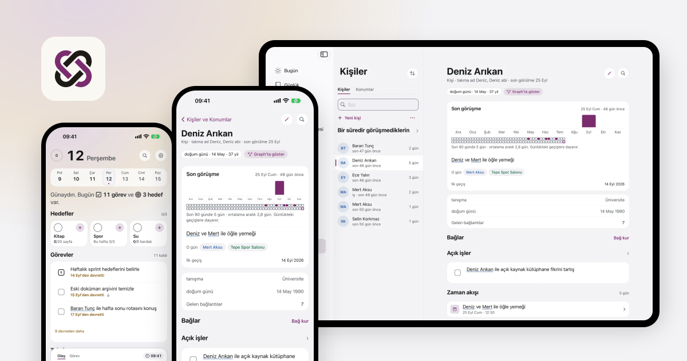
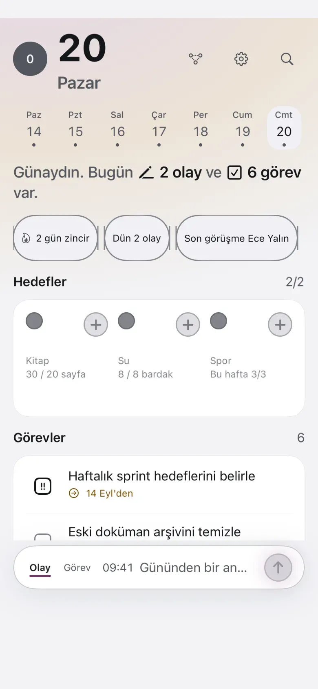
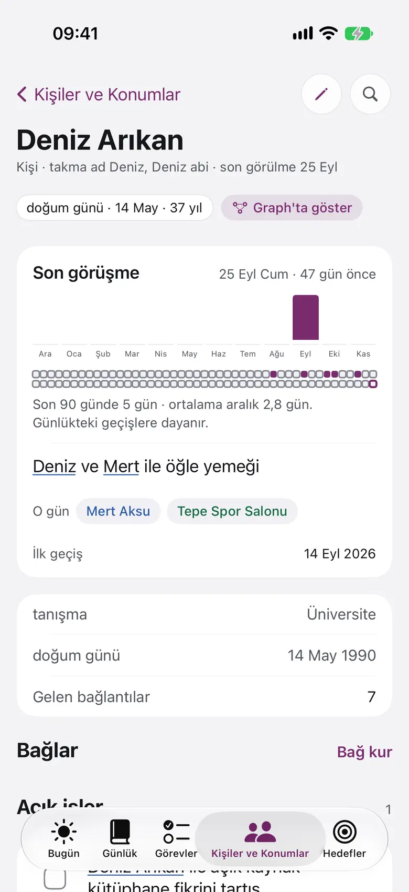
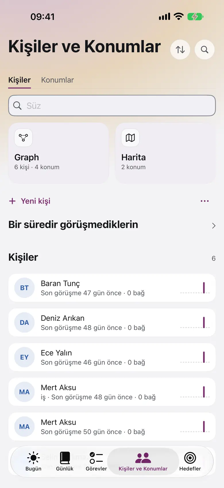
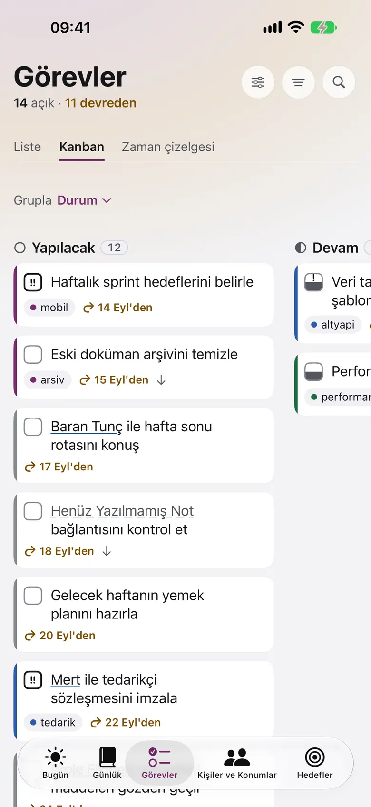
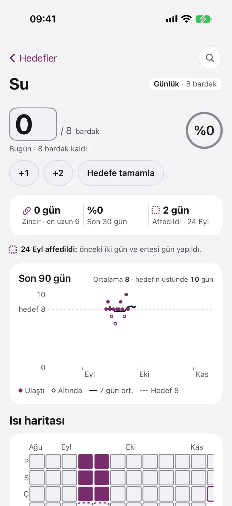
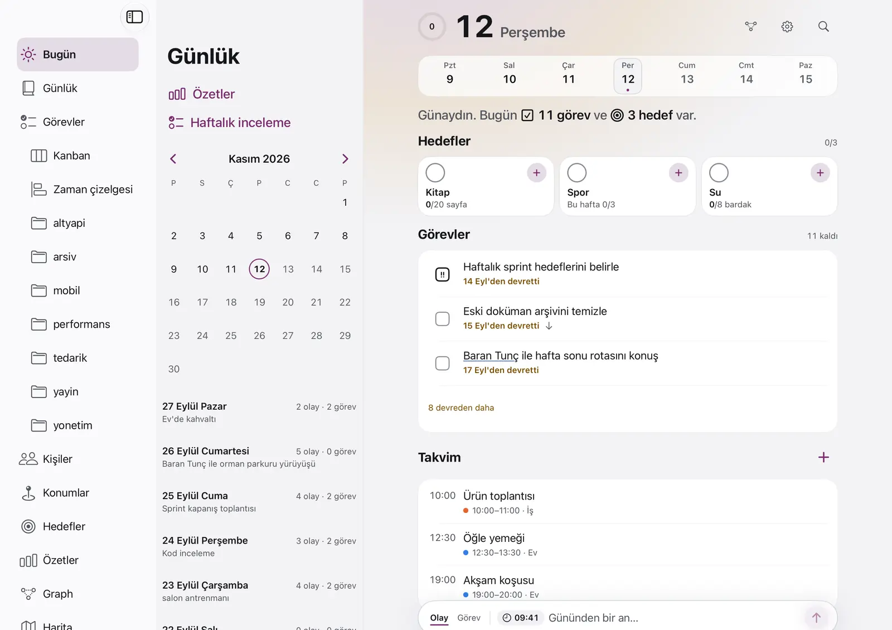

<p align="center">
  
</p>

<h1 align="center">Kenet</h1>

<p align="center">
  <b>Yaz; kim, nerede ve ne zaman kendiliğinden bağlansın.</b>
</p>

<p align="center">
  <a href="https://kenet.app">kenet.app</a> ·
  <a href="https://kenet.app/gizlilik">Gizlilik</a> ·
  <a href="https://kenet.app/destek">Destek</a> ·
  <a href="#english">English</a>
</p>

<p align="center">
  
</p>

Kenet, hesap gerektirmeyen ve verisini düz Markdown dosyalarında tutan kişisel bir günlüktür. Gün
içinde yazdığın kısa olayları kişilere, konumlara ve zamana kendiliğinden bağlar; kasan Obsidian
ile uyumludur.

Bu depo Kenet'in tanıtım sitesi **kenet.app**'in kaynağıdır. Uygulamanın kendisi
[dogancanyildiz/kenet](https://github.com/dogancanyildiz/kenet) deposundadır.

## Nasıl çalışır

Hızlı giriş alanına bir satır yazarsın:

```text
Ece ile Kadıköy'de kahve
```

Kasanda Ece ve Kadıköy varsa Kenet satırı o kişiye ve konuma bağlar. Gün dosyana düz Markdown olarak yazılır:

```markdown
- 09:41 [[Ece Yalın|Ece]] ile [[Kadıköy]]'de kahve ^a1b2c3
```

Belirsiz bir ad varsa uygulama sorar, tahmin etmez.

## Üç vaat

| Vaat                            | Ne demek                                                                                                                                                                                                                  |
| ------------------------------- | ------------------------------------------------------------------------------------------------------------------------------------------------------------------------------------------------------------------------- |
| **Veri senin**                  | Markdown gerçek kaynaktır, hesap yoktur. Dosyaları uygulama olmadan da okursun. iCloud Drive'daki ya da seçtiğin klasördeki kasa, uygulamayı silsen de kalır; iPhone ve iPad'de cihazdaki yerel kasa uygulamayla silinir. |
| **Hiçbir şey kaybolmaz**        | Kenet önce dosyaya yazar, sonra indeksi günceller. Tanımadığı metne dokunmaz. Silmede onay ya da geri alma vardır.                                                                                                        |
| **Başka platforma taşınabilir** | Kasa Obsidian ile aynıdır. Uygulamaya özgü sözdizimi yoktur, kasa şifrelenmez.                                                                                                                                            |

## Ekranlar

<p align="center">
  <picture>
    <source media="(prefers-color-scheme: dark)" srcset="public/screens/today-dark.webp">
    
  </picture>
  <picture>
    <source media="(prefers-color-scheme: dark)" srcset="public/screens/person-dark.webp">
    
  </picture>
  <picture>
    <source media="(prefers-color-scheme: dark)" srcset="public/screens/people-dark.webp">
    
  </picture>
  <picture>
    <source media="(prefers-color-scheme: dark)" srcset="public/screens/kanban-dark.webp">
    
  </picture>
  <picture>
    <source media="(prefers-color-scheme: dark)" srcset="public/screens/goal-dark.webp">
    
  </picture>
</p>

- **Kişinin geçmişi tek sayfada:** son görüşme, o günün kişi ve konumları. Takvim iznin varsa
  yaklaşan etkinlikler burada görünür.
- **Görevler Kanban'da da:** proje etiketli görevler durum sütunlarında; aynı görevler liste ve
  zaman çizelgesinde de.
- **Hedefe miktarla ilerle:** miktarı sayı klavyesiyle yaz, hızlı ekle ya da hedefe tamamla.
- **iPad:** kenar çubuğu, liste ve sayfa yan yana durur.

<p align="center">
  <picture>
    <source media="(prefers-color-scheme: dark)" srcset="public/screens/ipad-today-dark.webp">
    
  </picture>
</p>

## Durum

| Platform       | Durum                                                                |
| -------------- | -------------------------------------------------------------------- |
| iPhone ve iPad | Mağazaya ilk sürümle girer.                                          |
| Mac            | Mağazaya iPhone ve iPad sürümünden sonra girer.                      |
| Dil            | Arayüz Türkçe ve İngilizcedir; cihazda Kenet için seçili dili izler. |

Uygulama veri toplamaz, bu site çerez kullanmaz, hesap açmaz ve üçüncü taraf betik yüklemez.
Ayrıntı [gizlilik politikasında](https://kenet.app/gizlilik).

## Destek

Hata ve öneriler için uygulama deposunda
[konu aç](https://github.com/dogancanyildiz/kenet/issues). Hata bildirirken istenen bilgiler
[destek sayfasında](https://kenet.app/destek#report).

## Bu depo

Site Next.js ile yazılmıştır; her sayfa Türkçe kökte, İngilizce `/en` altındadır. Yerel kurulum,
betikler ve yayın akışı [docs/development.md](docs/development.md), belge haritası
[docs/README.md](docs/README.md) içindedir.

## English

**Kenet** is a personal journal that needs no account and keeps everything in plain Markdown
files. It links the short entries you write during the day to people, places and time on its own,
in a vault Obsidian can open.

This repository is the source of the Kenet website, [kenet.app](https://kenet.app/en). The app
itself lives in [dogancanyildiz/kenet](https://github.com/dogancanyildiz/kenet).
[Privacy](https://kenet.app/en/privacy) · [Support](https://kenet.app/en/support)

## Lisans

Site kodu ve metinleri için lisans kararı açıktır; karar verilene kadar tüm hakları saklıdır.
Kenet uygulamasının lisansı kendi deposundadır.
